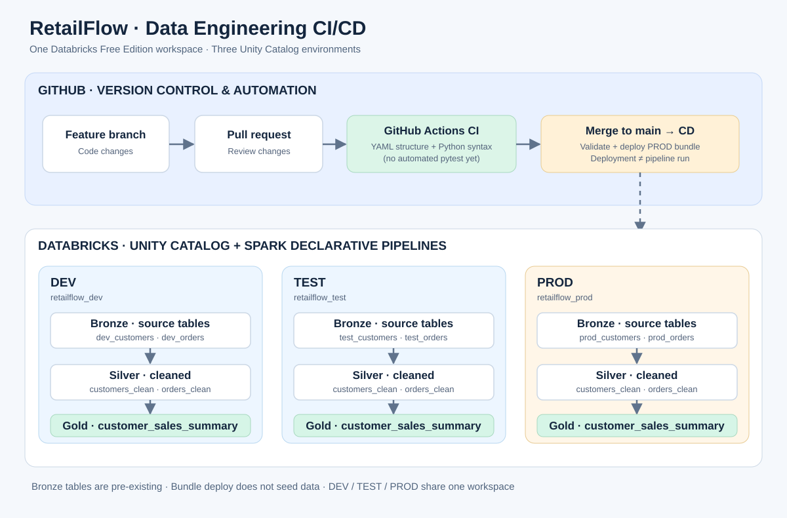

# RetailFlow | Databricks Data Engineering CI/CD

**Portfolio project:** A three-environment retail analytics pipeline built with PySpark, Databricks Spark Declarative Pipelines (SDP), Unity Catalog, Databricks Automation Bundles, and GitHub Actions.

**What it demonstrates:** source-to-report transformations, data quality expectations, environment-aware deployment, Git branching and pull requests, automated static checks, and deployment to Databricks.

> **Environment note:** DEV, TEST and PROD are separate Unity Catalog catalogs inside **one Databricks Free Edition workspace**—not three workspaces. This is an educational demonstration, not an enterprise production deployment.

## Architecture



The editable Mermaid source is in [docs/architecture.md](docs/architecture.md).

**Data flow:** existing Bronze customers/orders tables → PySpark Silver cleaning → Gold customer sales summary. **Delivery flow:** feature branch → pull request → GitHub Actions CI → merge to main → GitHub Actions CD → PROD bundle deployment.

## Verified pipeline runs (October 14, 2026)

| Environment | Pipeline | Bronze source tables | Silver customers | Silver orders | Gold customer summary | Result |
|---|---|---|---:|---:|---:|---|
| DEV | `[dev dapinders76] retailflow-cicd-dev` | `retailflow_dev.bronze.dev_customers`, `retailflow_dev.bronze.dev_orders` | 8 | 10 | 8 | Completed |
| TEST | `retailflow-cicd-test` | `retailflow_test.bronze.test_customers`, `retailflow_test.bronze.test_orders` | 12 | 20 | 12 | Completed |
| PROD | `retailflow-cicd-prod` | `retailflow_prod.bronze.prod_customers`, `retailflow_prod.bronze.prod_orders` | 16 | 25 | 16 | Completed |

These are **observed Databricks pipeline results** from screenshots, not results of a newly executed automated verification. The pipeline graph showed data quality expectations on its transformations.

## Repository structure

```text
.github/workflows/
  ci.yml                            # YAML structure + Python syntax checks
  cd.yml                            # Validate and deploy PROD bundle on main
docs/
  architecture.md                   # Editable Mermaid architecture
  architecture.svg                  # Rendered diagram
retailflow-bundle/
  databricks.yml                    # DEV / TEST / PROD variables and targets
  resources/
    retailflow_cicd.pipeline.yml   # SDP resource
    retailflow_dev_job.job.yml     # Lakeflow Job definition
  src/retailflow_cicd/
    transformations/               # PySpark transformations
  README.md                         # Bundle-specific usage
.gitignore
README.md
```

## Data model and processing

1. **Bronze:** `customers` and `orders` are pre-existing Unity Catalog tables; the bundle does not generate or load source data.
2. **Silver:** `customers_clean` and `orders_clean` apply PySpark transformations and pipeline data quality expectations.
3. **Gold:** `customer_sales_summary` produces a customer-level sales dataset for analytics.

The bundle injects the correct Bronze table names and catalog into pipeline configuration for each target:

| Target | Catalog | Customers input | Orders input |
|---|---|---|---|
| `dev` | `retailflow_dev` | `dev_customers` | `dev_orders` |
| `test` | `retailflow_test` | `test_customers` | `test_orders` |
| `prod` | `retailflow_prod` | `prod_customers` | `prod_orders` |

## CI/CD workflow

**Continuous integration —** [`.github/workflows/ci.yml`](.github/workflows/ci.yml) runs on pull requests to `main` and pushes to `feature/**` or `ci/**`. It parses YAML, checks the bundle target structure, and compiles Python to detect syntax errors. **It does not yet run automated PySpark unit tests or Databricks bundle validation.**

**Continuous deployment —** [`.github/workflows/cd.yml`](.github/workflows/cd.yml) runs on pushes to `main` or manual dispatch. It installs the Databricks CLI, validates the PROD bundle and deploys it. Successful GitHub Actions deployment has been observed. **Deploying a bundle does not automatically prove that the data pipeline executed successfully.**

GitHub configuration uses the repository variable `DATABRICKS_HOST` and secret `DATABRICKS_TOKEN`. Never commit access tokens or credentials. The current workflow deploys **directly to PROD** after merges; automated DEV → TEST → PROD approval gates are not implemented.

## Run locally (optional)

From the `retailflow-bundle` directory, with the Databricks CLI installed and authenticated:

```bash
databricks bundle validate -t dev
databricks bundle validate -t test
databricks bundle validate -t prod
databricks bundle deploy -t dev
```

To deploy another target, use `-t test` or `-t prod` **only when the target environment is prepared and you intend to update it**. The workspace UI also supports bundle deployment.

## Current limitations and next steps

- Automate the existing PySpark unit tests in CI (currently tested manually).
- Add approval gates and promotion across DEV → TEST → PROD.
- Add a reproducible data seeding process; Bronze source tables are prerequisites.
- Improve operational monitoring and add screenshots of CI, CD and pipeline runs.
- Prefer a service principal or supported short-lived authentication over a long-lived personal token when feasible.
- The Lakeflow Job schedule in the repository is **paused**; the successful pipeline runs above were observed separately.

## Technology stack

Databricks · Unity Catalog · Spark Declarative Pipelines · PySpark · Databricks Automation Bundles · Lakeflow Jobs · GitHub Actions · Git

---
**Purpose:** Demonstrate a realistic but appropriately scoped data engineering development and release workflow.
