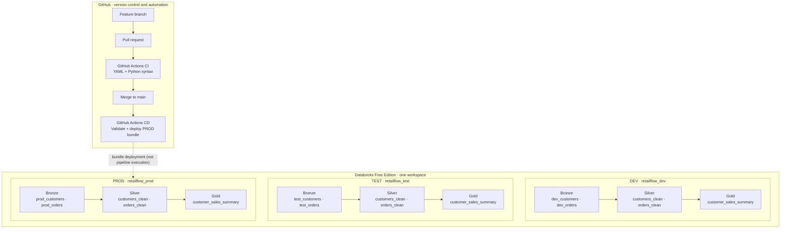

# RetailFlow architecture

The diagram below distinguishes **data processing** from **CI/CD deployment**. All three logical environments share a single Databricks Free Edition workspace.

**Important distinctions:** CI checks syntax and YAML structure, but does not currently run PySpark unit tests. CD deploys to PROD; it does not currently promote sequentially through DEV and TEST. Bronze source tables already exist and are not created by the bundle. Each target has its own catalog, but all targets use the same Databricks workspace.
